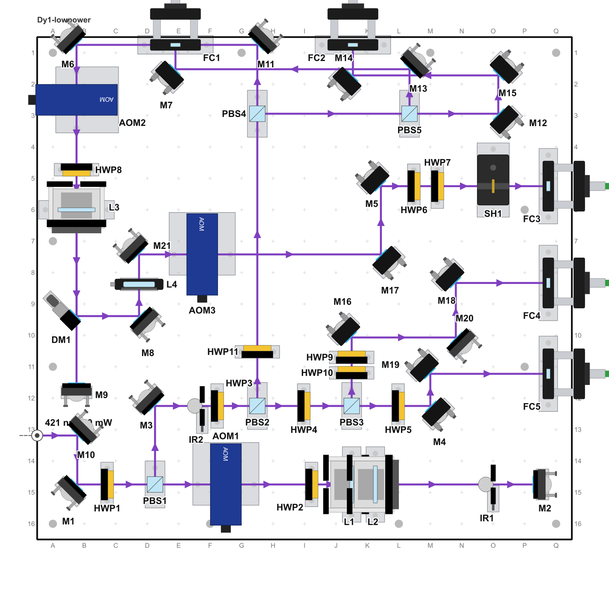
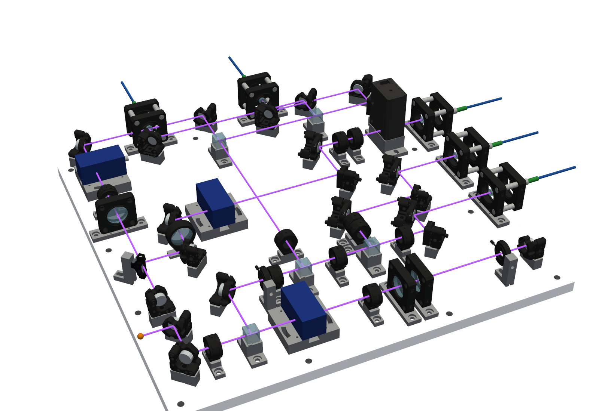
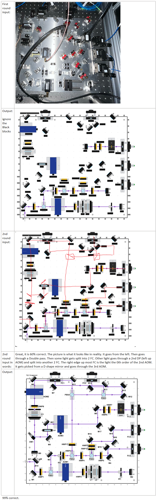
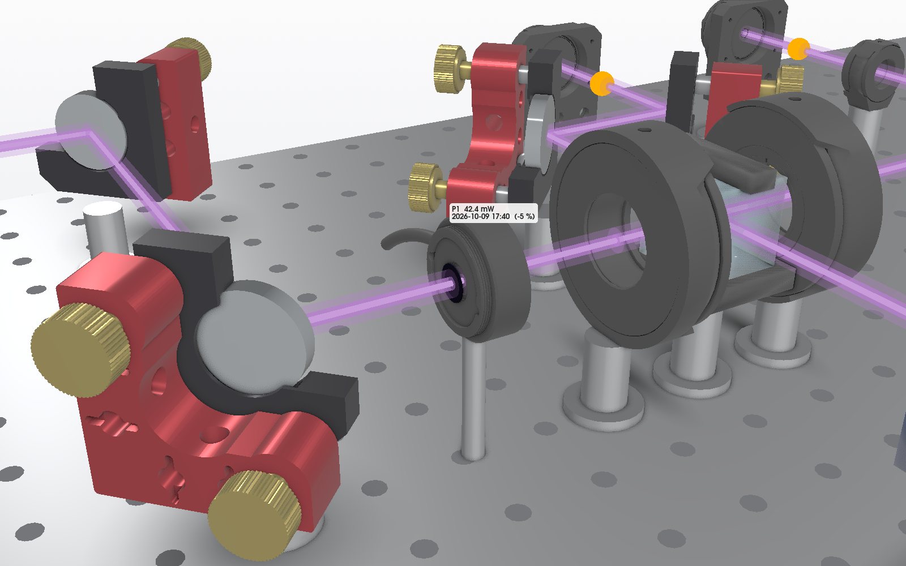

# Optical Layout Designer（光路布局设计器）

设计光学台或光学面包板上的布局，以 3D 预览装配效果，生成采购物料清单，并在装好后记录各处的光功率。

编辑方式类似 KiCad 的原理图和 PCB 编辑器。先在光路图中定义系统，再把同一组元件按真实尺寸摆放到平台上。两个视图实时联动。

布局编辑、功率日志、STEP 元件入库、Blender 导出和 Codex 用法均见[中文操作手册](docs/USER_AGENT_GUIDE.md)。

## 下载 macOS 应用

在 [GitHub Releases](https://github.com/TigerWang215/-blender-/releases) 查看发布记录，也可以[直接下载 Optical Layout Designer 1.0 的 ZIP](https://github.com/TigerWang215/-blender-/releases/download/macos-v1.0-20261125/Optical-Layout-Designer-1.0-macOS-arm64.zip)。解压后，把 `Optical Layout Designer.app` 拖到「应用程序」。

安装包适用于 **Apple 芯片 Mac，macOS 26.5 或更新版本**，内置 Python 及运行依赖。使用 Blender 导出功能时需要另行安装 Blender。安装包的签名说明见 [Release 安装说明](https://github.com/TigerWang215/-blender-/releases/tag/macos-v1.0-20261125)。





## 快速开始

本项目在 Windows 上使用 Python 3.13 开发和测试，也支持 macOS。各版本的更新见 [更新日志](CHANGELOG.md)。从源码启动可使用以下命令：

```sh
python -m pip install -r requirements.txt
python run.py examples/demo_schematic.json
```

`demo_schematic` 是适合上手的小型光路。运行 `python run.py` 可以新建空白布局。也可以打开更大的示例：

```sh
python run.py examples/demo_399nm.json           # 光束分配平台，附带功率日志
python run.py 421nm_system/Dy1-lowpower.json   # 上图所示的平台
```

如果布局包含功率测量点，打开时会询问如何处理缺失的日志文件。只想看看布局时，选择「打开布局（不加载日志）」。

## 示例：从照片重建布局

如果平台已搭好，可用 [Claude Code](https://claude.com/claude-code) 的 `photo-to-layout` 技能将俯拍照片转成可编辑的布局。照片能显示安装座的位置，光束走向通常需要补画。上图通过两轮完成。

将 `skills/photo-to-layout` 复制到 `.claude/skills`，然后把照片交给 Claude Code。

**第一轮：提供照片。** Claude 判断平台的类型和尺寸，校正透视，识别元件并放置到平台上。在这个 421 nm 的 LightFlow 示例中，大多数元件识别正确，光束路径约有 60% 正确，遗漏了两段双程光路。

**第二轮：提供标注和说明。** 在第一轮得到的图上用红线画出实际光束，再用几句话说明光路。示例描述如下：

> 光从左侧进入，先经过一段双程光路。其中一部分光分到两个光纤耦合器（FC），其余经过第二段双程（左上方的 AOM），再分到另外两个 FC。最右上方 FC 接收第二个 AOM 的零级光，这束光经 D 形反射镜引出，再经过第三个 AOM。

Claude 根据标注调整转向镜并连接光束。此次结果与实际布局约有 99% 一致，可直接打开：

```sh
python run.py 421nm_system/Dy1-lowpower.json
```

生成的文件可手动修正，也可查看 3D、导出物料清单和记录功率。脚本 [examples/make_dy1_lowpower.py](examples/make_dy1_lowpower.py) 记录了重建过程，可重新生成该布局。

对比图依次展示原照片、第一轮结果、红线标注、说明和最终布局。中间图的黑色方块是标签的占位符。



## 从零设计光学平台

### 1. 设置平台

按 Ctrl+N 新建布局，选择「文件 → 平台尺寸、孔位和形状」，调整尺寸并选择平台类型。平台类型决定安装方式和光束高度。

| 平台类型 | 元件安装方式 | 光束高度 |
|---|---|---|
| 经典 1 英寸孔距面包板 | 支柱固定在 1 英寸孔距的 1/4-20 螺纹孔上 | 可设定，默认 2 英寸 |
| Olego | 使用与安装座对应的立柱，固定在 4-40 螺纹孔上 | 2 英寸 |
| PyOpticL | 使用打印转接件或凹槽固定到基板 | ½ 英寸 |
| LightFlow | 用机加工底座固定到板上 | 1 英寸 |
| 预钻孔 | 在每个元件的支柱位置钻孔 | 可设定 |

### 2. 绘制光路图

在「光路图」选项卡 (Ctrl+1) 定义元件和连接。这里的元件位置便于阅读光路，实际位置在「平台布局」中设置。

1. 单击左侧符号，再单击画布放置。M1、L1、PBS1 等标签会自动填写。
2. 按 B，再沿光束传播方向依次单击元件。按 Esc 结束绘制。「新光束」决定线条颜色。
3. 要在已有光束中插入元件，放置时单击这段光束。
4. 选中元件后可设置类型和料号。按 Ctrl+T 打开可批量编辑的元件表。

### 3. 排布元件

「平台布局」(Ctrl+2) 按真实尺寸显示平台，并与光路图实时同步。可在此移动和旋转元件。

- 拖动元件可吸附到孔位。按住 Alt 拖动可临时关闭吸附。
- 反射镜自动沿入射和反射光束的角平分线定向。透镜、波片和光阑对准光束，分束立方体的面与光束对齐。
- R 和 Shift+R 旋转 ±45°，[ 和 ] 旋转 ±5°，A 恢复自动定向。
- 重叠元件会显示红色虚线边框。「平台布局 → 显示重叠元件」可选中它们。
- 按 L 测量距离，按 Ctrl+L 显示各段光束的长度。

后续加入的元件会出现在平台下方，拖到所需位置即可。「平台布局 → 按光路图重新排布」可重新按光路图的位置摆放所有元件。

双击布局上的元件可跳到光路图。两边的选择状态会同步。Ctrl+Tab 在两个选项卡之间切换。

### 4. 预览 3D

「3D」选项卡 (Ctrl+3) 显示安装座、支柱或底座，以及处于正确高度的光束。拖动旋转，滚轮缩放，Shift + 拖动平移。

仓库自带简化模型，可直接用于 3D 预览。3D 是可选功能，未安装 `pyvista` 时其他编辑功能仍可用。缺少模型的元件会显示为简化形状，3D 视图的提示会列出缺少的模型。可按 [添加元件](#添加元件) 中的步骤补充安装座模型。

### 5. 采购和共享

- **物料清单** (Ctrl+Shift+B) 列出元件、支柱和转接件，可从「文件」菜单导出 CSV。
- **导出图片** 可保存当前视图。Ctrl+E 导出 SVG，Ctrl+Shift+E 导出 PNG。
- **保存布局** (Ctrl+S) 将两个视图保存为同一个 JSON 文件。

## 记录实验功率

平台搭好后，可继续使用同一布局维护功率日志。

1. 在「平台布局」按 M，再单击光束添加测量点。单击光纤耦合器可测量光纤输出功率，并查看耦合效率。按住 Shift 可连续添加。
2. 单击测量点录入功率、功率计和备注，时间会自动记录。日志可查看历史和趋势图，也可从文件或剪贴板添加光斑照片。
3. 布局上的测量点显示最新读数。与上一次读数相比变化达到 10% 时，圆环会变红或变绿。

3D 中的橙色圆点表示功率测量点。将鼠标移到圆点上，会显示安装在支柱上的 Thorlabs S121C 功率探头及最新读数。单击可打开日志。



移动元件时，读数仍属于原测量点。删除光束时，测量点会归档。日志保存在布局文件旁的 `<布局文件名>.logbook.sqlite` 中。修正读数时，请添加一条新读数并说明原因。删除项目会将其隐藏，可从已删除列表恢复。

实验调校时可按 Ctrl+P 打开实验记录表，生成布局图和选定测量点的表格。可复制到 Excel、Word 或电子实验记录，也可另存为 PDF 或 CSV。「文件 → 导出功率日志（CSV）」可导出完整日志。

## 在平板或其他电脑上记录功率

同一局域网上的电脑、平板和手机可直接用浏览器查看布局、录入功率。例如在办公电脑上编辑，同时在光学台旁用笔记本录入。

```sh
python -m pip install -r web/requirements.txt
```

安装依赖后，启用「文件 → 网页访问（在局域网内共享）」即可从桌面程序启动网页服务。地址显示在菜单栏右上角。默认仅本机能访问，列表显示 `examples` 目录及当前打开的布局所在目录。

要向局域网共享：

1. 将 `web/config.example.json` 复制为 `web/config.json`，填写布局目录和访问密码，将 `host` 设为 `0.0.0.0`。
2. 重启程序，在其他设备上用浏览器打开菜单栏显示的地址，例如 `http://192.168.1.20:8000`。按需要在主机防火墙中允许访问该端口。

浏览器可以查看布局。读数和照片会写入与桌面版相同的日志。由桌面程序提供网页服务时，需保持程序运行。[网页端说明](web/README.md) 包含独立启动及防火墙设置方法。

## 添加元件

元件需要用于光路图和平台布局的二维符号。也可以用厂家提供的 STEP 文件生成 3D 模型。详见 [从 STEP 文件添加元件](component_library/README.md#从-step-文件添加元件)。

1. 将 STEP 文件放在 `component_library/step/`，对齐坐标后运行 `tools/simplify_cad.py` 生成简化网格。
2. 在 `optolayout/symbols.py` 中绘制二维符号并调用 `register()`，使它出现在工具栏里。
3. 在 `optolayout/mounts3d.py` 中关联模型和占地尺寸。对 Olego 或 LightFlow 平台，也要关联对应的立柱或底座。

仓库所附安装座的 STEP 来源见 [元件库说明](component_library/README.md)。

## 进阶用法

- **用 AI 辅助规划。** 除了上面的 `photo-to-layout`，`skills/` 中还有根据规格规划新平台的 `plan-board-layout`。将目录复制到 `.claude/skills` 即可在 Claude Code 中使用。它采用特定实验室的 Olego 设计规范，使用前请核对是否适合你的平台。
- **用脚本生成布局。** 参考 `examples/make_*.py`。布局是 JSON，参见 `optolayout/model.py`。每个元件有固定的 `id`，以及 `type`、`x`、`y`、`angle`、`label` 和 `part_number`。坐标以左上角为原点，单位为 mm，y 轴向下，角度单位为度。
- **高质量渲染。** `tools/render3d.py` 使用完整的 STEP 文件。需要从厂家取得这些文件，缺少 STEP 的安装座会被略过。详见 [3D 渲染](docs/3D_RENDER.md)。

```sh
python -m pip install cadquery-ocp mitsuba
python tools/render3d.py examples/demo_3d_simple.json examples/render/demo.png --theme dark
```

- **平台规格。** 参见 [Olego](docs/OLEGO_MATING.md)、[PyOpticL](docs/PYOPTICL_BOARD.md) 和 [LightFlow](docs/LIGHTFLOW_BOARD.md)。
- **运行测试。** `tests/` 中的脚本可独立运行，例如 `python tests/test_smoke.py`。

## 许可证和引用

本项目基于 [Jiahao Lyu 的 Optical Layout Designer](https://github.com/FrankLyu/Optical-Layout-Designer/tree/29d6961885281eb86f8e66cccd20f6af6295143e)，加入了中文界面、Blender 导出和束径预览等修改。源代码采用 MIT 许可证，原版权声明见 [LICENSE](LICENSE)。在工作中使用本项目时，请按 [CITATION.cff](CITATION.cff) 引用。二维符号的样式参考 Xingjian Lyu 的 399 nm 平台图。

`component_library/mesh/` 内的厂家模型由公开 CAD 简化而来，其形状仍归各厂家所有，适用各自的权利规则。项目与这些厂家无隶属关系。如厂家希望移除其模型，可提交 issue。
